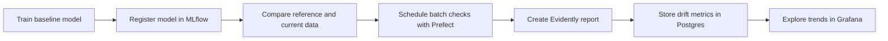

# Monitoring in ML

This repository teaches a practical monitoring workflow for a regression model trained on the NYC Green Taxi dataset. You start by training and tracking a model with MLflow, then inspect drift manually, then use Evidently to automate checks, and finally wire the results into a local monitoring stack built with Prefect, Postgres, and Grafana.

## Learning Path

1. [01-train-ml-model.ipynb](./01-train-ml-model.ipynb) trains a baseline trip-duration model and registers it in MLflow.
2. [02-intro-to-drift.ipynb](./02-intro-to-drift.ipynb) compares two months of taxi rides and measures drift with statistical distances.
3. [03-intro-to-evidently.ipynb](./03-intro-to-evidently.ipynb) creates Evidently reports and saves a reference dataset for later monitoring.
4. [04-evidently-in-batch-predictions.md](./04-evidently-in-batch-predictions.md) schedules batch monitoring with Prefect and visualizes metrics in Grafana.
5. [05-retrain-after-drift.ipynb](./05-retrain-after-drift.ipynb) retrains the model on a fresh labeled batch and promotes it if it improves the holdout score.



## Local Data Services

The batch-monitoring chapter uses a local monitoring stack defined in [docker-compose.yml](./docker-compose.yml):

- `Postgres` stores drift metrics produced by the Prefect flow.
- `Grafana` reads that table and displays the provisioned monitoring dashboard.

Bring the stack up when you are ready for the batch-monitoring chapter:

```bash
docker compose up -d
```

The default local endpoints are:

- Grafana: `http://127.0.0.1:3000`
- Postgres: `localhost:5555`
- Prefect UI: `http://127.0.0.1:4200`

## Mermaid Diagrams

The Mermaid diagram in this README renders directly on GitHub and in other Mermaid-capable Markdown previewers.

## Create the Python environment

### `macOS` / `Linux`

```bash
pyenv local 3.11.3
python -m venv .venv
source .venv/bin/activate
python -m pip install --upgrade pip
python -m pip install -r requirements.txt
```

### `Windows`

For `Git Bash` CLI:

```bash
pyenv local 3.11.3
python -m venv .venv
source .venv/Scripts/activate
python -m pip install --upgrade pip
python -m pip install -r requirements.txt
```

For `PowerShell` CLI:

```powershell
pyenv local 3.11.3
python -m venv .venv
.venv\Scripts\Activate.ps1
python -m pip install --upgrade pip
python -m pip install -r requirements.txt
```

Then copy the default local environment file:

**`macOS`** / **`Linux`** / **`Git Bash`**

```bash
cp .env.example .env
```

**`PowerShell`**

```powershell
Copy-Item .env.example .env
```

After copying `.env.example` to `.env`, keep the default local URLs unless you intentionally change the local stack ports.

## Quick Local MLflow Start

If you want a fully local setup, start MLflow from the repository root in a new terminal:

```bash
mlflow ui --backend-store-uri ./mlruns --port 5000
```

Then keep the default value from `.env.example`:

```bash
MLFLOW_TRACKING_URI=./mlruns
```

You can still open the MLflow UI at `http://127.0.0.1:5000`.

## Learning Objectives

By the end of this repository, you should be able to:

- train and track a regression model with MLflow;
- distinguish data drift from prediction drift;
- build and interpret an Evidently monitoring report;
- save a reusable reference dataset for production-style checks;
- schedule recurring monitoring runs with Prefect;
- retrain and promote a refreshed model when drift signals justify it;
- visualize drift metrics in Grafana from a Postgres table.
