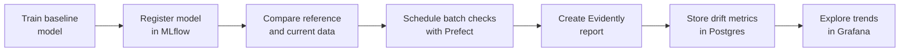

# Monitoring in ML

This repository shows a practical monitoring workflow for a regression model trained on the NYC Green Taxi dataset. You start by training and tracking a model with MLflow, inspect drift manually, then use Evidently to automate checks, and finally wire the results into a local monitoring stack built with Prefect, Postgres and Grafana.

## Learning Path

- [01 - Train an ML model](./01-train-ml-model.ipynb): Train a baseline trip-duration model and register it in MLflow.
- [02 - Intro to model and data drift](./02-intro-to-drift.ipynb): Compare two months of taxi rides and measure drift with statistical distances.
- [03 - Intro to Evidently](./03-intro-to-evidently.ipynb): Create Evidently reports and save a reference dataset for later monitoring.
- [04 - Evidently in batch predictions](./04-evidently-in-batch-predictions.md): Schedule batch monitoring with Prefect and visualize metrics in Grafana.
- [05 - Retraining after drift](./05-retrain-after-drift.ipynb): Retrain the model on a fresh labeled batch and promote it if it improves the holdout score.



## Local Data Services

The batch monitoring chapter uses a local monitoring stack defined in [docker-compose.yaml](./docker-compose.yaml):

- `Postgres` stores drift metrics produced by the Prefect flow.
- `Grafana` reads that table and displays the provisioned monitoring dashboard.

Bring the stack up when you are ready for the batch monitoring chapter:

```bash
docker compose up -d
```

The default local endpoints are:

- Grafana: `http://127.0.0.1:3000`
- Postgres: `localhost:5555`
- Prefect UI: `http://127.0.0.1:4200`

## Mermaid Diagrams

This repository contains Mermaid diagrams. If you want them to render in VS Code, we recommend installing the `Markdown Preview Mermaid Support` extension:

- [Install in VS Code](vscode:extension/bierner.markdown-mermaid)
- [View on Marketplace](https://marketplace.visualstudio.com/items?itemName=bierner.markdown-mermaid)

## Environment

Please make sure you **use this repository as a template** and set up a new virtual environment. You can use the following commands:

### **`macOS`** / **`Linux`**

```bash
pyenv local 3.11.3
python -m venv .venv
source .venv/bin/activate
python -m pip install --upgrade pip
python -m pip install -r requirements.txt
```

### **`Windows`**

For `Git Bash` CLI:

```bash
pyenv local 3.11.3
python -m venv .venv
source .venv/Scripts/activate
python -m pip install --upgrade pip
python -m pip install -r requirements.txt
```

For `PowerShell` CLI:

```powershell
pyenv local 3.11.3
python -m venv .venv
.venv\Scripts\Activate.ps1
python -m pip install --upgrade pip
python -m pip install -r requirements.txt
```

Then copy the default local environment file:

**`macOS`** / **`Linux`** / **`Git Bash`**

```bash
cp .env.example .env
```

**`PowerShell`**

```powershell
Copy-Item .env.example .env
```

After copying `.env.example` to `.env`, keep the default local URLs unless you intentionally change the local stack ports.

## Quick Local MLflow Start

If you want a fully local setup, start MLflow from the repository root in a new terminal:

```bash
mlflow ui --backend-store-uri ./mlruns --port 5000
```

Then keep the default value from `.env.example`:

```bash
MLFLOW_TRACKING_URI=./mlruns
```

You can still open the MLflow UI at `http://127.0.0.1:5000`.

## Learning Objectives

By the end of this repository, you should be able to:

- Train and track a regression model with MLflow.
- Distinguish data drift from prediction drift.
- Build and interpret an Evidently monitoring report.
- Save a reusable reference dataset for production-style checks.
- Schedule recurring monitoring runs with Prefect.
- Retrain and promote a refreshed model when drift signals justify it.
- Visualize drift metrics in Grafana from a Postgres table.
